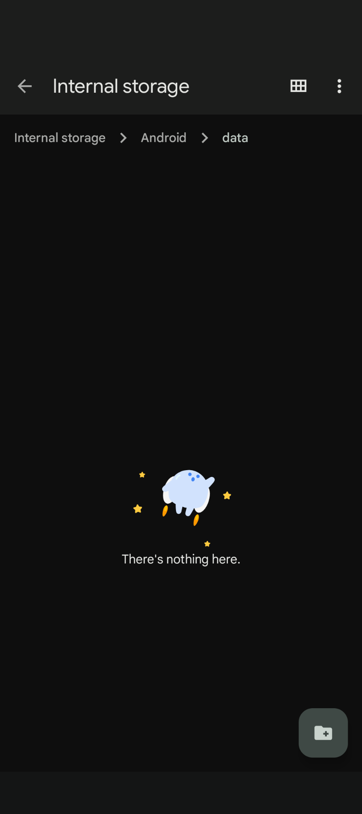
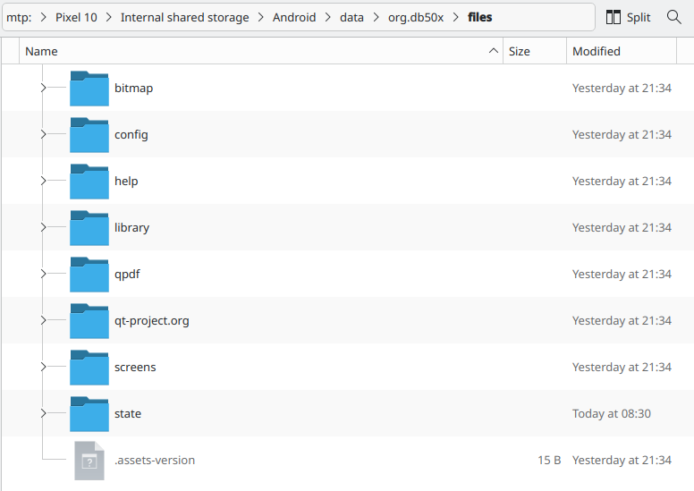
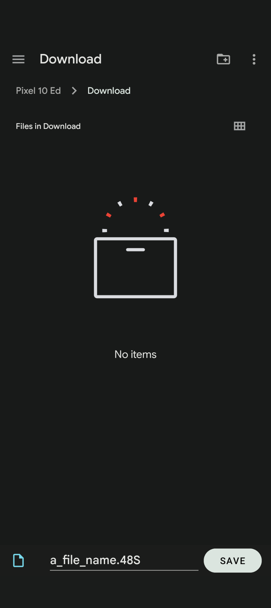
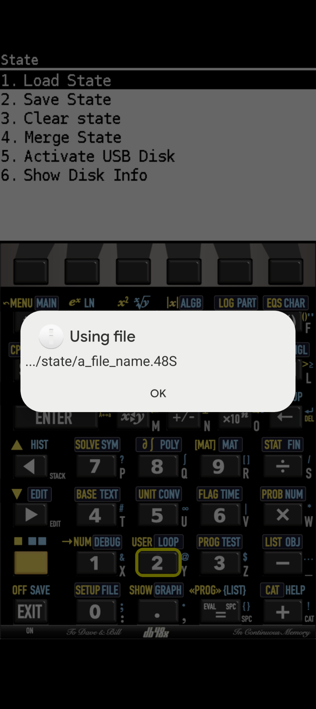
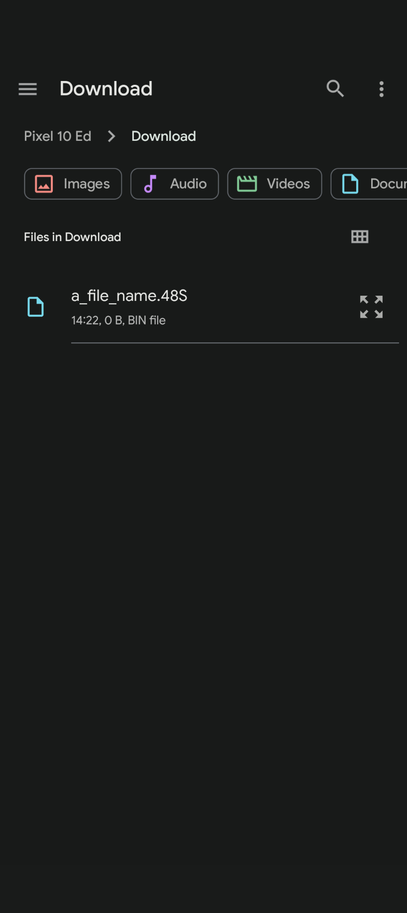

This document describes noteworthy specifics about DB50X (or DB48X) on Android.

# Use of files

DB48X comes with a set of configuration, help and (library) rpl program files.
You can add your own programs.
You can `Store` stack objects in a file and can `Recall` an object from a file to the stack.

You can work on or with those files with your android device or your computer.

## On your Android device

The location of these files on Android is `.../Android/data/org.db50x/files/`.
Unfortunately the Android `Files` App doesn't allow you to see or access that direcory
as is shown in the screenshot below.
The message is incorrect.
There is a lot there.
The Android `Files` App is just not allowed to show it.

Note that the screenshots here show a relevant state in the process.
At the top of the screenshot there are a few lines that show where this is in the file structure.
How you get there from activating the App, will require some navigation tapping.
That is not shown or described here in detail.

You need an other File Manager App, like `Cx File Explorer`,
that does have permissions to access `.../Android/data/`.
Even `Cx File Explorer` is restricted.
It does show the contenct of  `.../Android/data/`.
It does allow to navigate to and to enter `.../Android/data/org.db50x`.
Then it can't go further as shown in the first screenshot below.
But it does provide a way out via `System File Manager`.
That does give you access to  `.../Android/data/org.db50x/files/` as shown in the second screenshot below..

With the `System File Manager` App you can work on or with the DB50X files.
You can e.g. copy files to or from your Google Drive.
You could backup and restore your files.

## With a computer

Attach your Android device over USB to your computer.
With the appropriate settings you can then use your computers file manager to work with the files.
You could edit configuration files.
You could add your own rpl program files.
Last but not least, you could make a backup of anything you need to keep.

The partial screenshot below shows the use of the Dolphin file manager on linux.
From the root of the Android device, `Pixel 10` here,
the path to the relevant files, as shown at the top, is followed.

## state or keymap files

State files reside in `.../state/*.48S`, keymap files in `.../config/*.48k`.
From the system menu you can Load, Save or Merge a state file or you can Load a keymap.
Those operations require selecting or specifing a file through the `File selector` dialog.
There is also some automatic under the hood handling of such files.

The `File selector` has similar problems as the `Files` App (see above).
It is not allowed to access `.../Android/data/org.db50x/files/`.
So it can't give you the oppartunity to select files there.
The `File selector` opens in an other location, often the `Download` location.

### Save State

The `Save State` operation from the system menu calls the `File selector`.
It allows you to specify a name for the state file.
The default is a_file_name with the extension 48S
as shown in the screenshot below.

You tap the SAVE button.
Android then immediatly creates an empty file with that name in the current location.

DB50X takes over.
It takes the name of the specified file and saves the state,
not in the file that Android created
but in a file in the appropriate directory.
A message about the used file is presented
as shown in the screenshot below.

### Load State, Merge State or Load keymap

The `Load State` operation from the system menu calls the `File selector`.
It allows you to select a file
as shown in the screenshot below.

Note that the a_file_name.48S shown in the above screenshot is empty.
That doesn't matter, only its name is relevant (see below).

You select the wanted file.

DB50X takes over.
It takes the name of the selected file and reads the state,
not from the selected file
but from a file with the same name in the appropriate directory.
A message about the used file is presented.

If you want to read a state or keymap file, you know exists,
but for which there is no entry to select in `Download`,
you can create one with the `Files` App.
Try to `Merge State` Demo.48S that way.

The `Merge State` and `Load keymap` operations work similar.

# Install

DB48X is not available in the Google Play Store.
The projects github pipeline does build .aab files.
But these aren not uploaded to the store.

The pipeline also builds .apk files.
The intent is to provide those as a release asset.
Android users can then, on their Android device, download the .APK file and sideload / install it.

Warning

A new installation will, at first launch, copy a new version of the above mentioned files over the existing ones.
If you have made changes to any of those files, those changes will be lost.
If you need to keep those changes, you should backup the changed files before you install a new version of the App.
After the installation you can reapply the changes.
Do not replace a new configuraton file with your own older one.
There may be release related changes which should be kept.
Merge your changes into the new file.

# Build

In a future version of this document a description of how to build the App will be given here.